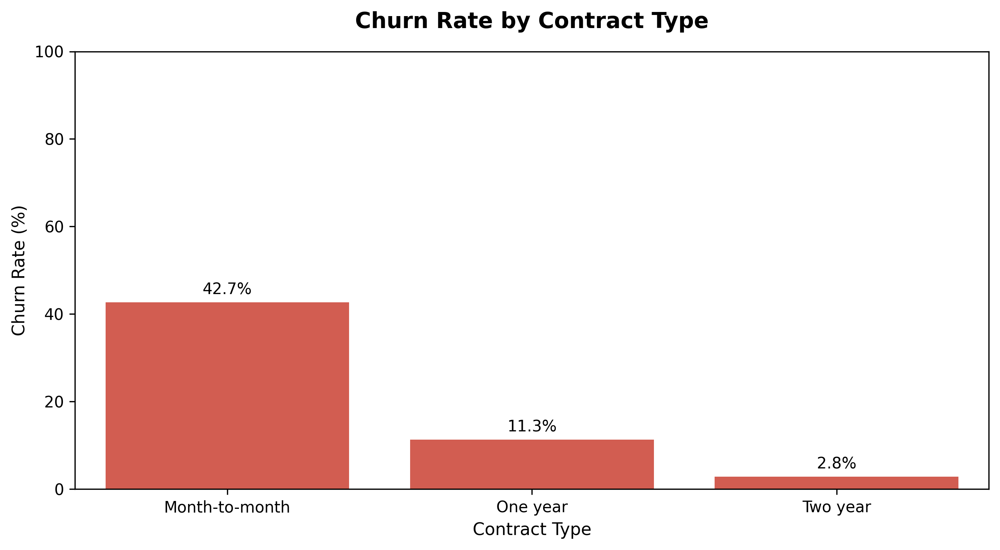
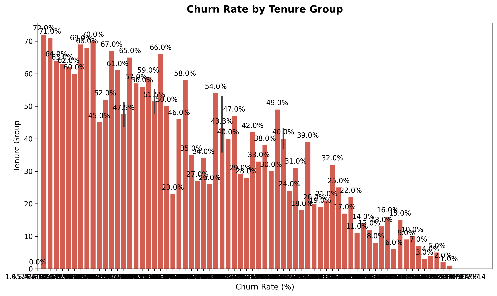
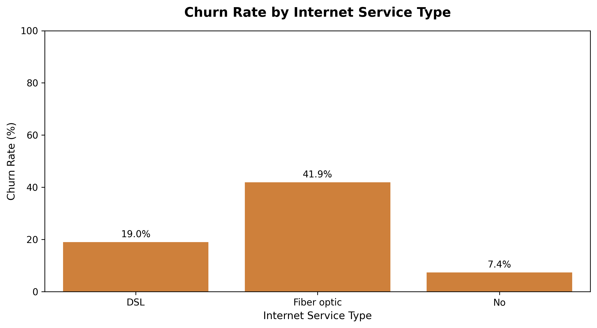
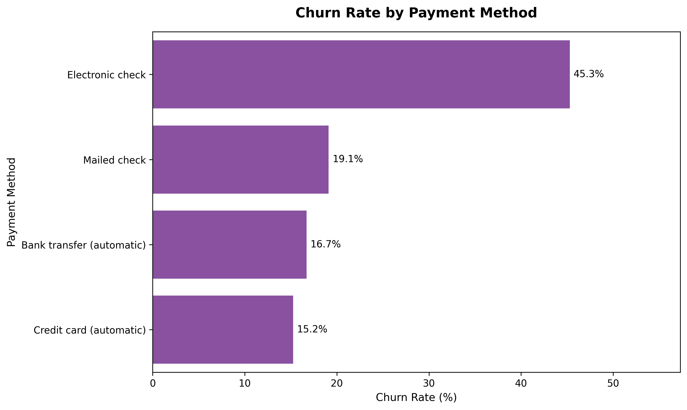
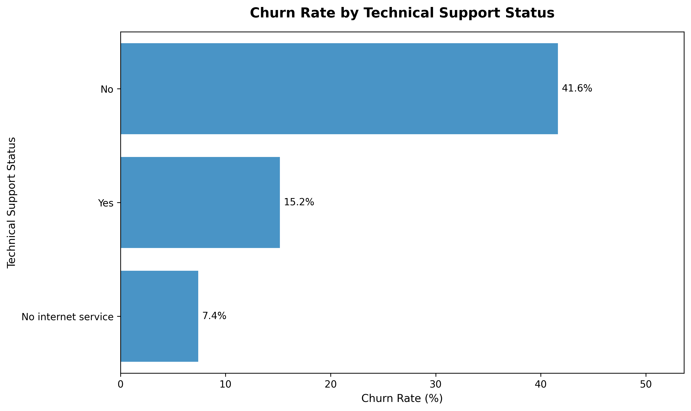
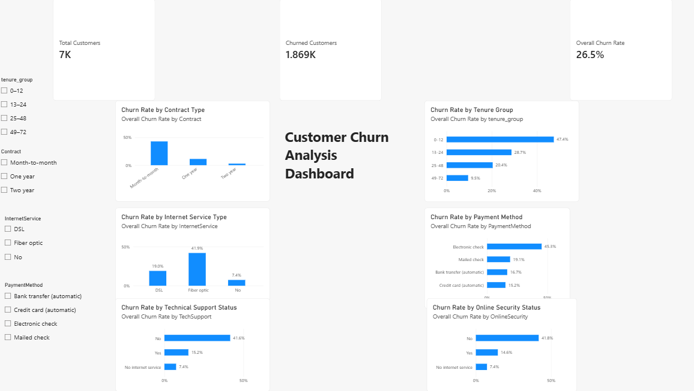

# Customer Churn Analysis

**Month-to-month fiber-optic customers without tech support churn at 71.07%, compared with an overall churn rate of 26.54%.**

## Business Problem

The telecom provider needs to identify which customers are most likely to cancel service and understand the factors driving churn. This analysis segments customers by contract type, tenure, internet service, payment method, and support services to prioritize retention actions.

The analysis found a clearly defined high-risk group of 833 customers with a 71.07% churn rate—about 2.7 times the company-wide average.

## Dataset

- **Source:** [IBM Telco Customer Churn – Kaggle](https://www.kaggle.com/datasets/blastchar/telco-customer-churn)
- **Rows:** 7,043 customers  
- **Columns:** 21  
- **Target variable:** `Churn` (`Yes` / `No`)  
- **Overall churn rate:** 26.54% (1,869 churned customers)  

The dataset includes customer demographics, tenure, contract details, internet and phone services, billing information, payment method, and churn status.

The repository contains both versions of the data:

```text
data/Telco-Customer-Churn.csv          # original raw dataset
data/customer_churn_cleaned.csv        # cleaned dataset generated by the notebook
```

## Approach and Data Cleaning

The analysis was completed in `notebooks/customer-churn-analysis.ipynb` using Python, Pandas, Matplotlib, and Seaborn.

The notebook loads the raw dataset and performs the following steps:

- Inspected the dataset structure, data types, and missing values.
- Converted `TotalCharges` to a numeric data type.
- Handled 11 blank `TotalCharges` values, all belonging to new customers with zero tenure.
- Standardized categorical values and verified that there were no missing values after cleaning.
- Created tenure groups to compare churn across customer lifecycle stages.
- Created monthly-charge groups for billing analysis.
- Analyzed churn by contract type, internet service, payment method, tech support, online security, tenure, and monthly charges.
- Saved the cleaned dataset as `data/customer_churn_cleaned.csv`.

## Key Findings

- **Overall churn rate:** 26.54% (1,869 of 7,043 customers).
- **Tenure:** Customers with 0–12 months of tenure churn at **47.44%**, compared with **28.71%** for 13–24 months, **20.39%** for 25–48 months, and **9.51%** for 49–72 months.
- **Contract type:** Month-to-month customers churn at **42.71%**, compared with **11.27%** for one-year contracts and **2.83%** for two-year contracts.
- **Internet service:** Fiber-optic customers churn at **41.89%**, compared with **18.96%** for DSL customers.
- **Payment method:** Electronic-check customers churn at **45.29%**, compared with **16.71%** for bank transfer and **15.24%** for credit card.
- **Tech support:** Customers without tech support churn at **41.64%**, compared with **15.17%** for customers with tech support.
- **Monthly charges:** Churned customers have an average monthly charge of **74.44**, compared with **61.27** for retained customers.

These findings show association, not proof of cause. For example, fiber-optic service is associated with higher churn, but price, service quality, customer expectations, and contract type may also contribute.

## High-Risk Segments

| Segment | Customers | Churned customers | Churn rate |
|---|---:|---:|---:|
| Month-to-month + Fiber optic + No tech support | 833 | 592 | **71.07%** |
| Month-to-month + Electronic check | 1,850 | 994 | **53.73%** |
| Month-to-month + No online security | 2,631 | 1,343 | **51.05%** |

**Note:** These segments overlap, so customer counts should not be added together.

The primary high-risk segment—month-to-month fiber-optic customers without tech support—contains 833 customers, or **11.8% of all customers**, but accounts for **592 of 1,869 churned customers**, or about **31.7% of all churn**.

The pattern is not limited to one segment: month-to-month customers using electronic check and month-to-month customers without online security also churn above 50%. The overlap between month-to-month contracts, higher-risk services or payment methods, and missing support services makes these customers especially vulnerable to cancellation.

## Visualizations











## Power BI Dashboard



`powerbi/Customer_Churn_Dashboard.pbix` presents the main churn metrics in an interactive dashboard, including overall churn rate, churn by contract type and tenure group, churn by internet service and payment method, monthly-charge distribution, and high-risk customer segments.

## Business Recommendations

1. **Target the 833-customer high-risk segment first.** Offer proactive tech-support onboarding, service check-ins, and retention incentives.
2. **Promote annual or two-year contracts.** Month-to-month customers churn at 42.71%, while two-year customers churn at only 2.83%.
3. **Improve the fiber-optic customer experience.** Fiber-optic customers churn at 41.89%, so investigate price perception, service quality, and installation or support issues.
4. **Encourage automatic payments.** Electronic-check customers churn at 45.29%, compared with 16.71% for bank transfer and 15.24% for credit card.
5. **Bundle tech support for new fiber customers.** Customers without tech support churn at 41.64%, compared with 15.17% for customers with tech support.
6. **Prioritize early-tenure customers.** Customers with 0–12 months of tenure churn at 47.44%, so focus retention efforts during the first year of service.

As an illustrative scenario—not a forecast—if retention efforts reduced churn in the 833-customer high-risk segment by 10 percentage points, from 71.07% to approximately 61.07%, about **83 customers** could be retained.

## Tools Used

- Python
- Jupyter Notebook
- Pandas
- NumPy
- Matplotlib
- Seaborn
- Power BI

## Repository Structure

```text
customer-churn-analysis/
│
├── data/
│   ├── Telco-Customer-Churn.csv
│   └── customer_churn_cleaned.csv
│
├── images/
│   └── dashboard and analysis charts
│
├── notebooks/
│   └── customer-churn-analysis.ipynb
│
├── powerbi/
│   └── Customer_Churn_Dashboard.pbix
│
├── requirements.txt
└── README.md
```

## How to Run

1. Clone the repository:

```bash
git clone [https://github.com/Keyuri-31/customer-churn-analysis.git](https://github.com/Keyuri-31/customer-churn-analysis.git)
```

2. Move into the project folder:

```bash
cd customer-churn-analysis
```

3. Install dependencies:

```bash
pip install -r requirements.txt
```

4. Start Jupyter Notebook:

```bash
jupyter notebook
```

5. Open and run:

```text
notebooks/customer-churn-analysis.ipynb
```

## Future Improvements

- Build and evaluate a machine-learning model to predict individual churn probability.
- Perform statistical significance testing for churn differences across customer segments.
- Add feature-importance analysis to rank the strongest churn drivers.
- Create a customer-level risk score for retention targeting.
- Deploy the dashboard or prediction model as an interactive application.

## Author

**Keyuri**  
[GitHub – Keyuri-31](https://github.com/Keyuri-31)